# NetPulse - KMP

**NetPulse** - KMP is a **Kotlin Multiplatform** project targeting Android, iOS and Desktop, built with Compose Multiplatform, Nav 3 (Navigation 3), Flow, Koin, Ktor, Room Database, DataStore, NSUserDefaults and Material3 based on MVVM architecture.

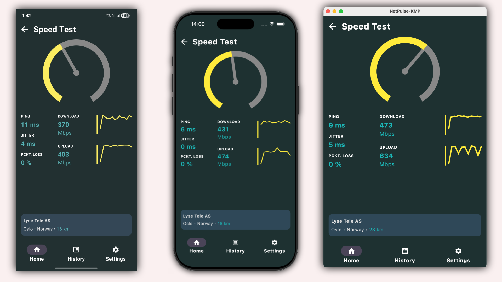

It is an app designed to help you find your current network speed.

## Features

- Tracking your download and upload network speed 
- Displaying Ping, Jitter and Packet Loss
- Configurable test duration and number of pings
- History screen to check and delete previous results
- Dark and Light theme

### Screenshots

<div style="display: flex;">
    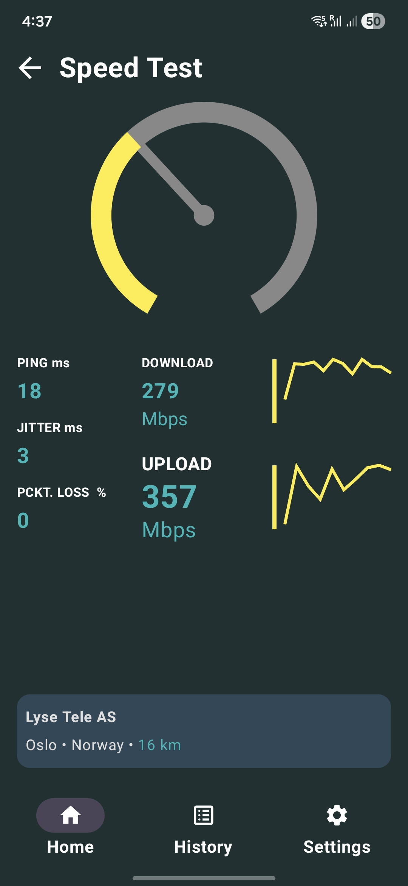
&nbsp; &nbsp; &nbsp; &nbsp;
    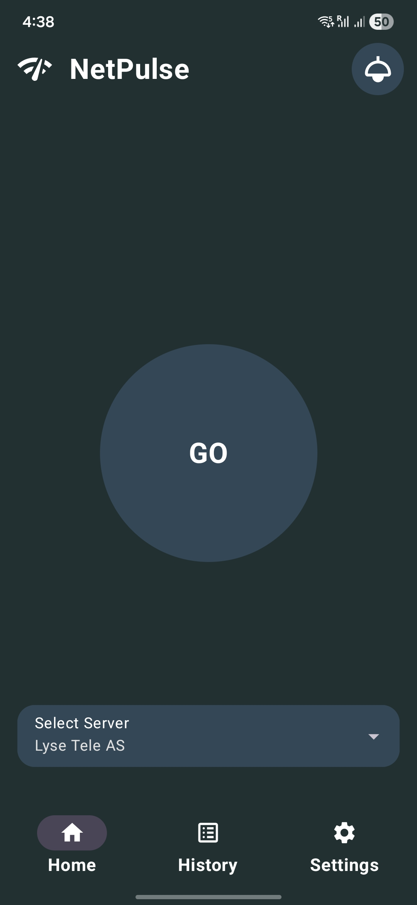
&nbsp; &nbsp; &nbsp; &nbsp;
    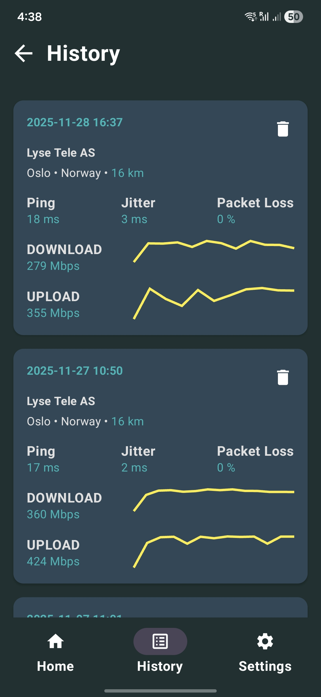
&nbsp; &nbsp; &nbsp; &nbsp;
    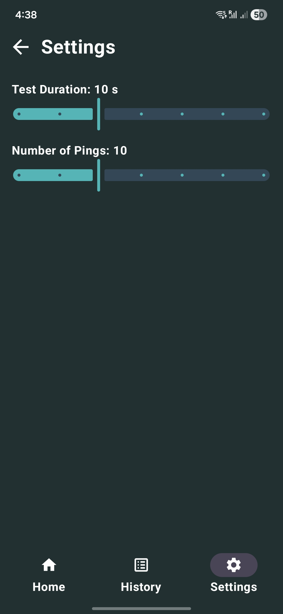
&nbsp; &nbsp; &nbsp; &nbsp;
    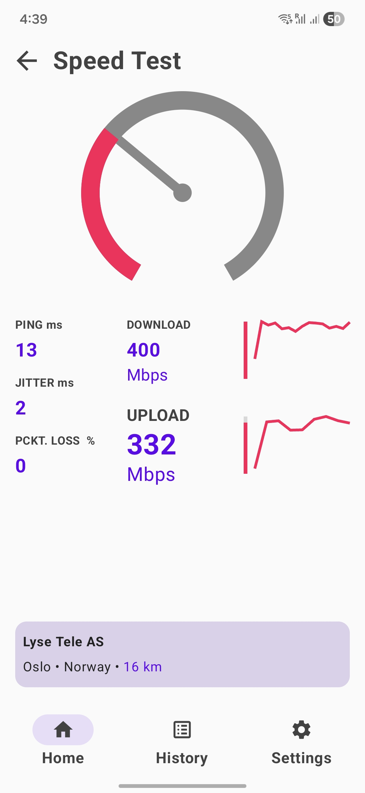
&nbsp; &nbsp; &nbsp; &nbsp;
    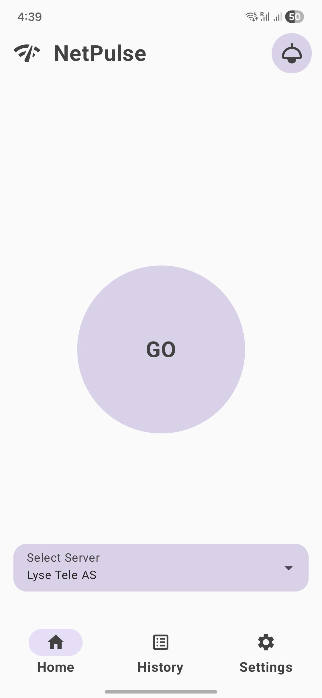
&nbsp; &nbsp; &nbsp; &nbsp;
    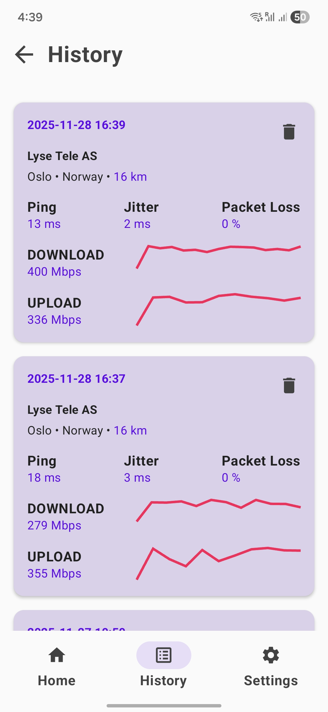
&nbsp; &nbsp; &nbsp; &nbsp;
    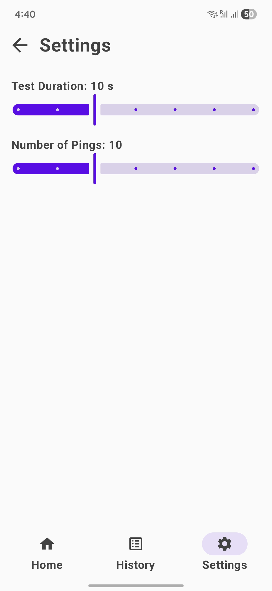
</div>

### Usage
On Home screen the closest server is selected by default. You can change it in Servers list drop down menu.
Click on GO button to start testing your network speed.
On History screen you can check and delete previous results.
On Settings screen you can change test duration and number of pings.
You can change app theme by using the icon at the top right on the Home screen.


## Tech Stack

This is a **Kotlin Multiplatform** project targeting Android, iOS and Desktop.

**NetPulse** - KMP is built using a modern stack of technologies designed to offer robust performance and scalability:
- **Compose Multiplatform**: For building native UIs.
- **Ktor**: For network operations.
- **Room Database**: For local data storage.
- **MVVM (Model-View-ViewModel)**: Architectural pattern.
- **DI Koin**: Dependency injection.
- **DataStore**: For Android data storage and management.
- **NSUserDefaults**: For iOS data storage and management.
- **Nav 3**: For navigating between screens.
- **Material 3**: Latest Material Design components.

## Architecture

**NetPulse** - KMP follows [Google's official architecture guidance](https://developer.android.com/topic/architecture).

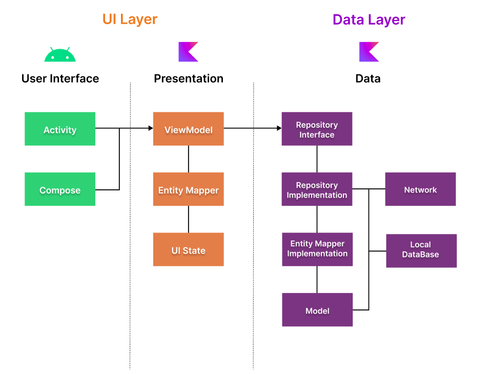

NetPulse - KMP was built with [Guide to app architecture](https://developer.android.com/topic/architecture), so it would be a great sample to show how the architecture works in real-world projects.

The overall architecture is composed of two layers; UI Layer and the data layer. Each layer has dedicated components and they each have different responsibilities. The arrow means the component has a dependency on the target component following its direction.


### Architecture Overview

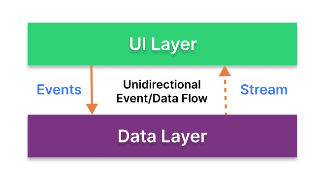

Each layer has different responsibilities below. Basically, they follow [unidirectional event/data flow](https://developer.android.com/topic/architecture/ui-layer#udf).


### UI Layer

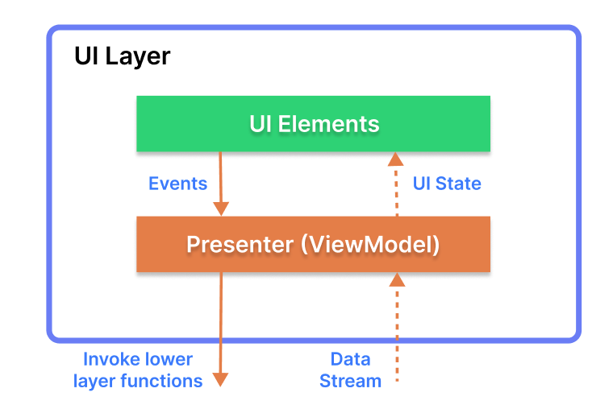

The UI Layer consists of UI elements like buttons, menus, tabs that could interact with users and [ViewModel](https://developer.android.com/topic/libraries/architecture/viewmodel) that holds app states and restores data when configuration changes.


### Data Layer

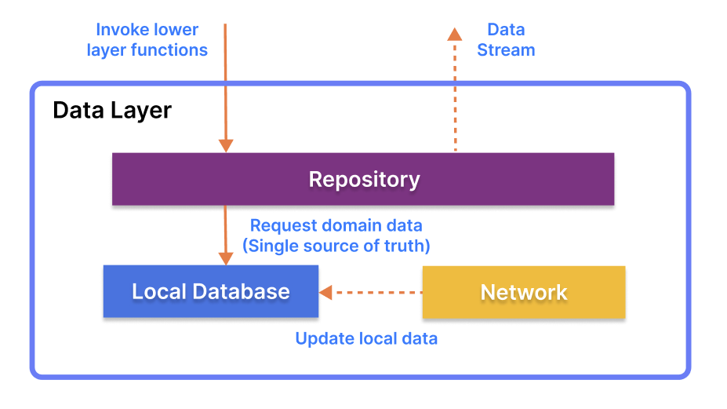

The data Layer consists of repositories, which include business logic, such as querying data from the local database and requesting remote data from the network. It is implemented as an offline-first source of business logic and follows the [single source of truth](https://en.wikipedia.org/wiki/Single_source_of_truth) principle.

## Development

### Modules

- `composeApp`: shared Compose UI and application logic, platform implementations, and Koin/Room code generation.
- `androidApp`: Android launcher and application configuration.
- `desktopApp`: desktop launcher and application packaging.
- `iosApp`: Xcode application that embeds the shared Kotlin framework.

The desktop target and its platform implementations remain in `composeApp/src/desktopMain`.

### Android

Build the debug application:

```sh
./gradlew :androidApp:assembleDebug
```

### Desktop

Run the desktop application:

```sh
./gradlew :desktopApp:run
```

In Android Studio, use a Gradle run configuration for `:desktopApp:run`.

Compile and build the desktop JAR:

```sh
./gradlew :desktopApp:jar
```

Create an application directory with a bundled runtime, or a macOS installer:

```sh
./gradlew :desktopApp:createDistributable
./gradlew :desktopApp:packageDmg
```

Packaging requires a full JDK that includes `jpackage`; some IDE-bundled runtimes do not include it. Desktop outputs are under `desktopApp/build/`. Native installers are built on the corresponding operating system.

### iOS

Build and run the existing `iosApp` Xcode project on the selected device or simulator. The Kotlin build phase embeds the framework for Xcode builds and explicitly syncs Compose resources when Android Studio handles framework compilation.

When `JAVA_HOME` is unset, the Xcode build script looks for a bundled JDK in `/Applications/Android Studio Personal.app` and `/Applications/Android Studio.app`. An explicitly configured `JAVA_HOME` takes precedence.

For a standalone debug framework, choose the task matching the destination:

```sh
# iOS Simulator on an Intel Mac
./gradlew :composeApp:linkDebugFrameworkIosX64

# iOS Simulator on an Apple Silicon Mac
./gradlew :composeApp:linkDebugFrameworkIosSimulatorArm64

# Physical iPhone or iPad
./gradlew :composeApp:linkDebugFrameworkIosArm64
```

These tasks build the framework; use Xcode or Android Studio's iOS run configuration to launch the application. Native compilation caching uses Kotlin's defaults. After changing the toolchain, test both an initial build and a rebuild after a small Kotlin change on the Intel simulator.

### Generated code and manual checks

Normal builds run Koin and Room code generation. If generated Koin imports are missing, rerun metadata generation:

```sh
./gradlew :composeApp:kspCommonMainKotlinMetadata --rerun-tasks
```

Then build the affected platform. Routine builds do not require `clean`.

Before merging, check server selection, starting and cancelling a speed test, download/upload speeds, ping/jitter/packet-loss display, history persistence and deletion, settings persistence, theme switching, and behavior without a network connection. Check Android, desktop, and the Intel iOS Simulator, including iOS launches from both Xcode and Android Studio. Also launch the packaged desktop application to check its bundled runtime, resources, and Room database support.

### License
Designed and developed by Vladan Mitkovic (2025)

Licensed under the Apache License, Version 2.0 (the "License");
you may not use this file except in compliance with the License.
You may obtain a copy of the License at

http://www.apache.org/licenses/LICENSE-2.0

Unless required by applicable law or agreed to in writing, software
distributed under the License is distributed on an "AS IS" BASIS,
WITHOUT WARRANTIES OR CONDITIONS OF ANY KIND, either express or implied.
See the License for the specific language governing permissions and
limitations under the License.
